# Đặc tả Kỹ thuật & Tài liệu Kiến trúc Hệ thống — Dự án Phân loại Cấp cứu ESI 1–5 (FedMML)

> **Đối tượng đọc:** Thành viên Nhóm 01, giảng viên hướng dẫn và người phản biện kỹ thuật.
> **Mục tiêu tài liệu:** Đặc tả kiến trúc tổng thể, quy trình tiền xử lý, cơ chế tối ưu Out-of-Fold (OOF) không rò rỉ Validation, chứng minh mô hình học tốt cùng hai nghiên cứu kiểm chứng sâu (**Chuyên biệt ESI 4–5** & **Độ ổn định 10 lần chia nhóm độc lập**) và hướng dẫn chốt Baseline / tái lập kết quả.
> **Mốc chuẩn chốt dự án (Final Synchronized Release):**
> - **Main OOF Anti-Overfit Run:** `run_id = fd81afda6ebcb7ea` (đồng bộ 100% OOF CV trên toàn bộ pipeline, notebook và gói phát hành)
> - **OOF Balancing Study:** `study_id = ceca64f75da026d8`
> - **Specialist ESI 4–5 Study:** `study_id = 2b141a247c81f58d`
> - **10-Split Distinct Group Stability Study:** `study_id = ce0302bc4a643c2f`
> - **Demo 2.2 Lab-Free & Review Policy Study:** `study_id = 6bd3b9114c4adb75`

---

## 1. Tổng quan Bài toán & Phạm vi Kỹ thuật

- **Bài toán:** Phân loại đa lớp mức độ ưu tiên cấp cứu theo thang **Emergency Severity Index (ESI)** gồm 5 mức từ **ESI 1** (nguy kịch, cần hồi sức ngay) đến **ESI 5** (không khẩn cấp, không cần tài nguyên xét nghiệm/thủ thuật).
- **Dữ liệu nguồn:** [FedMML Emergency Department Triage Dataset](https://huggingface.co/datasets/olaflaitinen/fedmml-ed-triage) (`data/raw/fedmml_ed_triage_dataset.csv`, DOI `10.57967/hf/7825`, giấy phép CC BY 4.0).
  - Quy mô: **87.234 ca khám tổng hợp**, gắn với **96 `patient_id` mô phỏng** từ 6 cơ sở thuộc 3 quốc gia (Đan Mạch, Latvia, Thổ Nhĩ Kỳ).
  - **Cảnh báo phạm vi:** Dữ liệu hoàn toàn tổng hợp (không có bệnh nhân thật). Sinh hiệu và xét nghiệm được sinh theo mức ESI; nhiều `patient_id` có tuổi và giới tính thay đổi qua các lượt khám. Kết quả dùng cho nghiên cứu và đánh giá phương pháp học máy, **không dùng cho quyết định lâm sàng thực tế**.
- **Phương pháp cốt lõi:** **100% Thuần Học máy cổ điển trên dữ liệu dạng bảng** (`scikit-learn 1.9.0` + `xgboost 3.2.0`), không dùng Deep Learning, không dùng LLM và không dùng luật cứng (hardcoded rules) để gán nhãn ESI.
- **Bốn mô hình chính được so sánh:**
  1. `LogisticRegression` (Mô hình tuyến tính đa lớp có điều chuẩn L2).
  2. `RandomForest` (Tập hợp cây quyết định theo cơ chế Bagging).
  3. `XGBoost` (`FoldWeightedXGB` — Gradient Boosted Decision Trees theo cơ chế Histogram `hist`).
  4. `SoftVoting` (`FrozenSoftVoting` — Trộn xác suất có trọng số giữa `RandomForest` và `XGBoost` đã đóng băng).

---

## 2. Kiến trúc Tổng thể Hệ thống (End-to-End Architecture)

```mermaid
flowchart TD
    RAW["CSV Nguồn FedMML<br/>87.234 ca · 96 ID mô phỏng<br/>(Kiểm chứng SHA-256)"] --> CLEAN["Giai đoạn 1: Làm sạch xác định<br/>src/fedmml_triage/data.py<br/>• Loại trùng hoàn toàn, chặn xung đột encounter_id<br/>• Giá trị ngoài BOUNDS → NaN (2.033 giá trị)<br/>• Giữ nguyên NaN, không điền toàn cục"]

    CLEAN --> SPLIT["Chia tập cố định theo patient_id<br/>configs/split_plan.json (Overlap = 0)<br/>• Train: 61.049 ca (58 ID)<br/>• Validation: 13.124 ca (15 ID)<br/>• Test: 13.061 ca (23 ID)"]

    SPLIT --> FE["Trích xuất 38 đặc trưng đầu vào theo dòng<br/>make_features() — Chặn 6 cột FORBIDDEN<br/>• 19 biến gốc + 6 biến sinh lý/đếm thiếu<br/>• 3 cờ thiếu đặc thù + 7 thời gian chu kỳ + 3 phân loại"]

    FE --> CV["3-fold StratifiedGroupKFold (theo patient_id)<br/>src/fedmml_triage/experiment.py<br/>Mỗi fold fit lại toàn bộ ColumnTransformer (46 đặc trưng):<br/>• Winsorize 0,5%–99,5% · Log1p cho 6 xét nghiệm lệch<br/>• Median Imputer cho LR/RF · Giữ NaN gốc cho XGBoost<br/>• StandardScaler cho biến liên tục · Giữ nguyên cờ & chu kỳ"]

    CV --> TUNE["1. Chọn siêu tham số chống overfit bằng RandomizedSearchCV<br/>2. Refit trên toàn Train (100% không chạm Validation)<br/>3. Sinh xác suất Out-of-Fold (OOF) trên 3 fold Train"]

    TUNE --> OOF["Tối ưu ngưỡng & SoftVoting hoàn toàn trên OOF Train<br/>src/fedmml_triage/decision.py<br/>• Học hệ số α = (α₁..α₅) tối đa hóa OOF Macro F1<br/>• Học trọng số trộn rf_weight của SoftVoting trên OOF<br/>(Validation hoàn toàn không bị chạm tới)"]

    OOF --> VAL["Đánh giá khách quan 1 lần trên Validation (13.124 ca)<br/>• Chọn mô hình thắng cuộc (Macro F1 → Macro Recall → AUC)<br/>• Đóng băng toàn bộ .joblib & ghi model_lock.json (SHA-256)"]

    VAL --> TEST["Mở tập Test đúng 1 lần sau khi kiểm chứng SHA-256<br/>• Tính Macro F1, Recall, ROC-AUC OvR, Accuracy, Confusion Matrix<br/>• Xuất test_metrics.json & evaluation_receipt.json"]

    TEST --> STUDIES["Các nghiên cứu kiểm chứng sâu (tách biệt)<br/>• Balancing OOF (ceca64f75da026d8)<br/>• Specialist ESI 4–5 (2b141a247c81f58d)<br/>• 10-Split Distinct Stability (ce0302bc4a643c2f)<br/>• Demo 2.2 Lab-Free XGBoost (6bd3b9114c4adb75)"]
```



### Bản đồ Mã nguồn & Thành phần Dự án

| Thư mục / Tệp | Vai trò kỹ thuật |
|---|---|
| `src/fedmml_triage/config.py` | Định nghĩa hằng số, danh sách đặc trưng, cột cấm `FORBIDDEN`, miền `BOUNDS` và `PROTOCOL` cố định. |
| `src/fedmml_triage/data.py` | Nạp dữ liệu, làm sạch xác định (`clean_data`), chia tập theo `patient_id` (`split_patients`), tạo 38 đặc trưng đầu vào (`make_features`). |
| `src/fedmml_triage/models.py` | `TrainQuantileClipper`, `FoldWeightedXGB`, bộ tiền xử lý theo thuật toán (`make_preprocessor`, 46 chiều) và lưới siêu tham số chống overfit (`model_spaces`). |
| `src/fedmml_triage/decision.py` | Tối ưu hệ số ngưỡng OOF `tune_class_weights`, bộ bọc `ValidationDecisionClassifier` và `FrozenSoftVoting`. |
| `src/fedmml_triage/experiment.py` | 3-fold `StratifiedGroupKFold`, `_oof_probabilities`, huấn luyện, khóa `model_lock.json` và đánh giá test có `evaluation_receipt.json`. |
| `src/fedmml_triage/balancing/` | Nhánh đối chứng thử nghiệm 6 chiến lược cân bằng lớp đã đồng bộ OOF CV (`study_id = ceca64f75da026d8`). |
| `src/fedmml_triage/studies/specialist_45.py` | Thử nghiệm 4 bộ phân loại nhị phân chuyên biệt ranh giới ESI 4–5 (`study_id = 2b141a247c81f58d`). |
| `src/fedmml_triage/studies/stability.py` | Đánh giá độ ổn định qua 10 lần chia nhóm `GroupShuffleSplit` hoàn toàn độc lập (`study_id = ce0302bc4a643c2f`). |
| `tools/run_deep_studies.py` | Kịch bản chạy trọn bộ pipeline OOF + Balancing + Specialist 4–5 + 10-Split Stability. |
| `tools/prepare_demo.py`, `evaluate_demo_updates.py`, `package_demo.py`, `package_cloud_demo.py` | Luồng phát hành Demo 2.2 & Cloud (đồng bộ OOF CV, đóng gói kèm `decision.py`, `SoftVoting` và `XGBoost` không xét nghiệm). |
| `tools/verify_project.py`, `verify_demo_review.py` | Bộ kiểm chứng tự động toàn bộ SHA-256 của dữ liệu nguồn, 2 notebook, model, test receipt và tất cả các study. |

---

## 3. Đặc tả Dữ liệu, Đặc trưng & Tiền xử lý

### 3.1. Phân bố dữ liệu và Chia tập cố định (`configs/split_plan.json`)

| Tập dữ liệu | Số ca | Số `patient_id` | ESI 1 | ESI 2 | ESI 3 | ESI 4 | ESI 5 | Overlap ID |
|---|---:|---:|---:|---:|---:|---:|---:|---:|
| **Train** | 61.049 | 58 | 620 (1,02%) | 11.755 (19,26%) | 29.000 (47,50%) | 16.226 (26,58%) | 3.448 (5,65%) | 0 |
| **Validation** | 13.124 | 15 | 142 (1,08%) | 2.536 (19,32%) | 6.231 (47,48%) | 3.471 (26,45%) | 744 (5,67%) | 0 |
| **Test** | 13.061 | 23 | 162 (1,24%) | 2.498 (19,13%) | 6.158 (47,15%) | 3.502 (26,81%) | 741 (5,67%) | 0 |
| **Tổng cộng** | **87.234** | **96** | **924** | **16.789** | **41.389** | **23.199** | **4.933** | **0** |

### 3.2. Danh sách Cột bị Loại bỏ (`FORBIDDEN`)
Tuyệt đối không đi vào ma trận đặc trưng: `patient_id`, `encounter_id`, `esi_level` (nhãn đích), `chief_complaint`, `clinical_notes` (văn bản tự do có nguy cơ lộ nhãn trong dữ liệu tổng hợp) và `arrival_timestamp` gốc.

### 3.3. Thiết kế 46 Chiều Đặc trưng sau Tiền xử lý (`make_features` $\rightarrow$ `make_preprocessor`)

Mọi đặc trưng dẫn xuất đều tính **độc lập theo từng dòng (row-wise)** trước bước cắt ngoại lai/điền khuyết; mọi tham số thống kê (phân vị, trung vị, trung bình, độ lệch chuẩn, danh mục One-Hot) **chỉ học trong từng fold train**:

| Nhóm trong `ColumnTransformer` | Các cột đầu vào | Số chiều đầu ra | Biến đổi với `LR` & `RandomForest` | Biến đổi với `XGBoost` | Lý do kỹ thuật |
|---|---|---:|---|---|---|
| **1. `continuous`** | `age`, 7 sinh hiệu (`systolic_bp`, `diastolic_bp`, `heart_rate`, `respiratory_rate`, `temperature`, `spo2`, `pain_score`), 5 xét nghiệm ít lệch (`hemoglobin`, `platelet_count`, `sodium`, `potassium`, `inr`) | **13** | `TrainQuantileClipper(0.5%, 99.5%)` $\rightarrow$ `SimpleImputer(median)` $\rightarrow$ `StandardScaler` | `TrainQuantileClipper(0.5%, 99.5%)` $\rightarrow$ **Giữ `NaN` gốc** $\rightarrow$ `StandardScaler` | Bảo vệ trước ngoại lai cực đoan; tận dụng cơ chế tách nhánh `NaN` tự nhiên (Sparsity-aware) của XGBoost thay vì ép giá trị trung vị của ESI 3 vào các ca ESI 4–5 không làm xét nghiệm. |
| **2. `log_labs`** | 6 xét nghiệm lệch phải mạnh: `bnp`, `troponin`, `glucose`, `wbc`, `creatinine`, `lactate` | **6** | `Clipper` $\rightarrow$ **`log1p`** $\rightarrow$ `Median Imputer` $\rightarrow$ `StandardScaler` | `Clipper` $\rightarrow$ **`log1p`** $\rightarrow$ **Giữ `NaN` gốc** $\rightarrow$ `StandardScaler` | Nén đuôi phân phối lệch hàm mũ (ví dụ `bnp` 0–10.000), giúp mô hình tuyến tính và cây học ranh giới mượt hơn. |
| **3. `derived` (Tỷ số sinh lý)** | `shock_index` ($\frac{\text{HR}}{\text{SBP}}$), `mean_arterial_pressure` ($\frac{\text{SBP} + 2\cdot\text{DBP}}{3}$), `pulse_pressure` ($\text{SBP} - \text{DBP}$) | **3** | `Clipper` $\rightarrow$ `Median Imputer` $\rightarrow$ `StandardScaler` | `Clipper` $\rightarrow$ **Giữ `NaN` gốc** $\rightarrow$ `StandardScaler` | Cung cấp trực tiếp các chỉ số huyết động phi tuyến mà cây chia trục tọa độ và hồi quy tuyến tính khó tự học. |
| **4. `counts` (Biến đếm)** | `danger_vital_count` (số sinh hiệu vượt ngưỡng nguy hiểm: $\text{HR}>100$, $\text{RR}>20$, $\text{SpO}_2<92$, $\text{SBP}<90$, $\text{Temp}>38$ hoặc $<36$), `missing_vitals_count` (0–7), `missing_labs_count` (0–11) | **3** | `passthrough` (giữ thang đếm tự nhiên) | `passthrough` | Thay thế 18 cờ báo thiếu rời rạc bị đa cộng tuyến nặng ở bản cũ; `missing_labs_count` phản ánh trực tiếp số tài nguyên xét nghiệm theo định nghĩa thang ESI. |
| **5. `missing_flags`** | `spo2_missing`, `troponin_missing`, `bnp_missing` | **3** | `passthrough` (giữ nhị phân 0/1) | `passthrough` | Chỉ giữ 3 biến có tỷ lệ khuyết độc lập cao nhất; không đưa qua `StandardScaler` để tránh làm lệch mức phạt L2. |
| **6. `temporal` (Chu kỳ)** | `hour_sin`, `hour_cos`, `day_of_week_sin`, `day_of_week_cos`, `month_sin`, `month_cos`, `is_weekend` | **7** | `SimpleImputer(median)` | `SimpleImputer(median)` | Mã hóa lượng giác giữ tính liên tục qua nửa đêm (`23:00` sát `00:00`), cuối tuần và cuối năm. |
| **7. `categorical`** | `sex` (2), `site_id` (6), `country` (3) | **11** | `SimpleImputer("UNKNOWN")` $\rightarrow$ `OneHotEncoder(handle_unknown="ignore")` | `SimpleImputer("UNKNOWN")` $\rightarrow$ `OneHotEncoder(handle_unknown="ignore")` | Xử lý an toàn các danh mục chưa từng gặp khi suy luận thực tế. |
| **Tổng cộng** | **38 đặc trưng đầu vào** | **46** | **46 cột số hữu hạn** | **46 cột (có `NaN` tự nhiên)** | Gọn hơn bản cũ (52 cột), sạch đa cộng tuyến và giàu thông tin sinh lý hơn. |

---

## 4. Đặc tả Mô hình, Siêu tham số & Tối ưu Ngưỡng OOF (`run=fd81afda6ebcb7ea`)

| Thuật toán | Không gian tìm kiếm chống Overfit (`model_spaces`) | Cấu hình tối ưu chọn trên 3-Fold CV | Hệ số ngưỡng OOF ($\alpha_1 \dots \alpha_5$) |
|---|---|---|---|
| **LogisticRegression** | `C` $\in \{0.01, 0.1, 1.0, 10.0\}$; `class_weight` $\in \{\text{None}, \text{balanced}\}$; `lbfgs`, L2, `max_iter=2000` | `C=10.0`, `class_weight=None` | `[1.414, 1.000, 0.841, 1.000, 1.000]` |
| **RandomForest** | `n_estimators` $\in \{150, 250\}$; `max_depth` $\in \{8, 10, 12\}$; `min_samples_leaf` $\in \{5, 10, 20\}$; `max_features` $\in \{\text{sqrt}, 0.5\}$; `class_weight` $\in \{\text{None}, \text{balanced\_subsample}\}$ | `n_estimators=150`, `max_depth=12`, `min_samples_leaf=10`, `max_features="sqrt"`, `class_weight="balanced_subsample"` | `[0.917, 1.000, 1.091, 1.000, 1.000]` |
| **XGBoost (`FoldWeightedXGB`)** *(Chốt Baseline chính thức theo Val)* | `n_estimators` $\in \{150, 250\}$; `max_depth` $\in \{3, 4, 5\}$; `learning_rate` $\in \{0.03, 0.05\}$; `min_child_weight` $\in \{5, 10, 20\}$; `subsample`, `colsample_bytree` $\in \{0.7, 0.8\}$; `reg_lambda` $\in \{2, 5, 10\}$; `reg_alpha` $\in \{0.1, 0.5, 1.0\}$; `gamma` $\in \{0.1, 0.5, 1.0\}$; `weight_mode` $\in \{\text{none}, \text{balanced}\}$ | `n_estimators=250`, `max_depth=5`, `learning_rate=0.05`, `min_child_weight=5`, `subsample=0.8`, `colsample_bytree=0.8`, `reg_lambda=5.0`, `reg_alpha=0.1`, `gamma=1.0`, `weight_mode="balanced"` | `[0.545, 0.500, 1.682, 1.091, 1.000]` |
| **SoftVoting (`FrozenSoftVoting`)** *(Đỉnh Test & Ổn định nhất 10-Split)* | Trộn $P_{\text{blend}} = w \cdot P_{\text{RF}} + (1 - w) \cdot P_{\text{XGB}}$ với $w \in \{0.25, 0.50, 0.75\}$ trên OOF Train | `rf_weight = 0.25` (25% RF + 75% XGBoost) | `[0.707, 0.648, 1.542, 1.091, 1.000]` |

---

## 5. Kết quả Chốt Baseline & Bằng chứng Mô hình Học Tốt

### 5.1. Bảng Kết quả Tổng hợp trên Tập Test Cố định (`13.061` ca, 23 ID — `run=fd81afda6ebcb7ea`)

| Mô hình | Train F1 | OOF Tuned F1 | Validation F1 | **Test Macro F1** | **Test Macro Recall** | **Test ROC-AUC OvR** | **Test Accuracy** | Recall ESI 1 | Recall ESI 2 | F1 ESI 4 | Recall ESI 5 |
|---|---:|---:|---:|---:|---:|---:|---:|---:|---:|---:|---:|
| *Dummy (Luôn đoán ESI 3)* | — | — | — | *12,82%* | *20,00%* | *50,00%* | *47,15%* | *0,00%* | *0,00%* | *0,00%* | *0,00%* |
| **LogisticRegression** | 74,50% | 74,22% | 74,07% | 74,66% | 75,34% | **96,18%** | **90,24%** | 90,74% | **96,68%** | **85,71%** | 0,00% |
| **RandomForest** | 85,42% | 77,11% | 76,41% | 77,00% | 76,87% | 96,08% | 85,22% | **99,38%** | 96,60% | 74,41% | **22,00%** |
| **XGBoost** *(Chốt theo Val)* | **84,13%** | **77,18%** | **76,86%** | **77,11%** | **76,73%** | **96,02%** | **85,79%** | **99,38%** | **95,72%** | 75,24% | **19,97%** |
| **SoftVoting** (`RF 0,25 + XGB 0,75`) | **84,66%** | **77,22%** | 76,84% | **77,42%** | **77,07%** | **96,06%** | **86,66%** | **99,38%** | **96,08%** | **77,18%** | 17,95% |

### 5.2. Ma trận Nhầm lẫn & Bằng chứng Học đúng Thứ tự Lâm sàng (`XGBoost` trên Test)

| Thực tế \ Dự đoán | Dự đoán ESI 1 | Dự đoán ESI 2 | Dự đoán ESI 3 | Dự đoán ESI 4 | Dự đoán ESI 5 | F1 từng lớp |
|---|---:|---:|---:|---:|---:|---:|
| **Thực tế ESI 1** (162 ca) | **161** | 0 | 1 | **0** | **0** | **99,69%** |
| **Thực tế ESI 2** (2.498 ca) | 0 | **2.391** | 107 | **0** | **0** | **97,51%** |
| **Thực tế ESI 3** (6.158 ca) | 0 | 15 | **6.031** | 85 | 27 | **95,26%** |
| **Thực tế ESI 4** (3.502 ca) | 0 | 0 | 287 | **2.474** | 741 | **75,24%** |
| **Thực tế ESI 5** (741 ca) | 0 | 0 | 78 | 515 | **148** | **17,86%** |

- **An toàn tuyệt đối trước lỗi hạ bậc nghiêm trọng:** **0 / 2.660 ca ESI 1–2 bị đoán nhầm thành ESI 4–5** (`0,00%`), và **Precision ESI 1 = 100%** (`161/161`).
- **Học đúng trật tự mức độ nặng (Ordinality):** Sai số gần như chỉ xảy ra giữa các mức kề nhau ($k \leftrightarrow k \pm 1$).
- **Kiểm soát Overfitting rõ rệt:** So với bản `max_depth=8` trước khi siết (`07f922dc873b5aca`: Train F1 = `95,25%`, chênh lệch Train–Val = `+18,34%`), bản chốt `fd81afda6ebcb7ea` kéo chênh lệch Train–Val của XGBoost xuống chỉ còn **`+7,27%`** (`Train Recall ESI 5` hạ từ `97,65%` về `54,84%`), trong khi Test F1 tăng lên `77,11%` và ROC-AUC tăng lên `96,02%`.

---

## 6. Kết quả Hai Nghiên cứu Kiểm chứng Sâu (Deep Studies)

### 6.1. Nghiên cứu 1A — Bộ phân loại Chuyên biệt Ranh giới ESI 4–5 (`study_id = 2b141a247c81f58d`)
Huấn luyện riêng 4 bộ phân loại nhị phân (`ESI 4` vs `ESI 5`) chỉ trên các mẫu thuộc `{4, 5}` trong từng fold train, kết hợp phân phối vào mô hình nền `XGBoost` và tối ưu ngưỡng trên Train OOF CV:

| Ứng viên (trên nền `XGBoost`) | OOF Macro F1 | Val Macro F1 | Val F1 ESI 4 | Val F1 ESI 5 | Val Recall ESI 5 | **Binary ROC-AUC (4 vs 5 trên Val)** | Đạt chuẩn Promotion? |
|---|---:|---:|---:|---:|---:|---:|---|
| **Base (`XGBoost` chốt)** | 77,18% | 76,86% | 74,19% | **18,78%** | **21,24%** | **0,4974** | *(Baseline đối chứng)* |
| `LogisticRegression_45_balanced` | 77,53% | 77,62% | 78,79% | 17,94% | 16,40% | **0,5057** | Không (F1 ESI 5 giảm) |
| `RandomForest_45_balanced` | 76,90% | 77,14% | 78,83% | 15,56% | 13,84% | **0,5179** | Không (F1 ESI 5 giảm) |
| `XGBoost_45_balanced` | 77,15% | 76,91% | 74,69% | 18,51% | 20,56% | **0,5042** | Không (F1 ESI 5 giảm) |
| `XGBoost_45_soft` | 77,23% | 76,79% | 79,72% | 13,39% | 11,16% | **0,5006** | Không (F1 ESI 5 giảm) |

> **Phát hiện khoa học cốt lõi (Bằng chứng chốt trần dữ liệu):**
> Khi tách hoàn toàn cặp `{ESI 4, ESI 5}` khỏi ESI 1–3, **ROC-AUC nhị phân của cả 4 thuật toán chuyên gia chỉ nằm trong khoảng `0,5006 – 0,5179`** (gần bằng tung đồng xu `0,50`). Điều này chứng minh một cách chặt chẽ rằng **trong bộ dữ liệu tổng hợp FedMML, khi loại bỏ văn bản, các biến số sinh hiệu và xét nghiệm giữa ESI 4 và ESI 5 được sinh gần như trùng khớp phân phối**. Mọi nỗ lực tăng cân bằng hay chuyên gia 2 tầng trên dữ liệu số chỉ đánh đổi qua lại giữa F1 ESI 4 và F1 ESI 5 dọc theo đường chéo ngẫu nhiên, **xác nhận dự án đã chạm giới hạn thông tin (Bayes error ceiling) của tập đặc trưng cấu trúc**.

### 6.2. Nghiên cứu 1B — Độ ổn định qua 10 Lần Chia nhóm Độc lập (`study_id = ce0302bc4a643c2f`)
Đánh giá trên **10 lần chia `GroupShuffleSplit(80% / 20%)` hoàn toàn riêng biệt** (mỗi lần giữ 20 `patient_id` chưa từng thấy làm holdout, xác minh `0` tập trùng lặp và `max_patient_overlap = 0`, lồng 3-fold OOF CV trong mỗi split train):

| Mô hình (10 Split Độc lập) | Macro F1 (Mean ± SD) | 95% CI Macro F1 | ROC-AUC OvR (Mean ± SD) | Accuracy (Mean ± SD) | Recall ESI 1 | Recall ESI 5 | Overfit Gap (Train – Holdout) | Số lần thắng / 10 |
|---|---|---|---|---|---|---|---|---:|
| **LogisticRegression** | 75,30% ± 1,17% | [74,57% – 76,02%] | **96,19% ± 0,06%** | **88,92% ± 1,29%** | 93,08% | 5,74% ± 7,47% | **+0,11%** | 0 / 10 |
| **RandomForest** | 76,98% ± 0,23% | [76,84% – 77,12%] | 96,06% ± 0,07% | 85,12% ± 0,38% | **98,16%** | **24,47% ± 2,38%** | +8,09% | 2 / 10 |
| **XGBoost** | 77,09% ± 0,35% | [76,87% – 77,30%] | 96,10% ± 0,07% | 86,44% ± 0,94% | 97,68% | 19,21% ± 5,45% | **+6,66%** | 3 / 10 |
| **SoftVoting** (`RF 0,25 + XGB 0,75`) | **77,22% ± 0,21%** | **[77,09% – 77,35%]** | 96,12% ± 0,07% | 86,74% ± 0,29% | 97,86% | 17,30% ± 1,07% | +7,17% | **5 / 10** |

> **Kết luận độ ổn định:**
> - **Độ ổn định rất cao:** Sai số chuẩn giữa 10 lần chia nhóm bệnh nhân khác nhau của `SoftVoting` chỉ **±0,21%**, `RandomForest` là **±0,23%**, `XGBoost` là **±0,35%**, và ROC-AUC ổn định quanh **96,1% ± 0,07%**.
> - **Giá trị của mô hình đơn lẻ vs Ensemble:** `XGBoost` thắng trên Validation cố định (`76,86%`) và có khoảng cách overfit thấp nhất trong họ cây (`+6,66%`); trong khi `SoftVoting` đạt **trung bình cao nhất (`77,22%`)**, **phương sai nhỏ nhất (`±0,21%`)** và thắng nhiều split nhất (**5/10 lần**, cao nhất trên Test cố định **`77,42%`**).

### 6.3. Nhánh Cân bằng lớp OOF (`ceca64f75da026d8`) & Mô hình Không xét nghiệm Demo 2.2 (`6bd3b9114c4adb75`)
- **Cân bằng lớp đồng bộ OOF (`ceca64f75da026d8`):** Trên nền 46 đặc trưng mới đã tối ưu ngưỡng OOF, không phương án lấy mẫu/trọng số nào vượt qua được điều kiện thay thế trên Validation (tốt nhất là `XGBoost / oversample_5_to_4` đạt Val F1 `76,60%` < baseline `76,86%`), do đó giữ nguyên baseline `XGBoost` và **không mở lại Test**.
- **Mô hình không xét nghiệm Demo 2.2 (`6bd3b9114c4adb75`):** Loại bỏ toàn bộ 11 biến xét nghiệm + `missing_labs_count` + `troponin_missing` + `bnp_missing`, huấn luyện lại kèm OOF CV trên Train. **`XGBoost · không xét nghiệm`** đạt **Val Macro F1 = 77,89%** trên 11.982 ca hợp lệ và giảm lỗi hạ bậc nặng ESI 1–2 $\rightarrow$ 3–5 từ **141 xuống 115 ca** (vượt chuẩn Promotion, đã tích hợp vào Demo 2.2).

---

## 7. Khuyến nghị Chốt Baseline & Luồng Phát hành Đồng bộ (Demo 2.2)

- **Baseline chính thức để chốt (theo đúng giao thức chọn trên Validation):** **`XGBoost` (`run=fd81afda6ebcb7ea`)** — Test Macro F1 **77,11%**, ROC-AUC **96,02%**, Accuracy **85,79%**, Recall ESI 1 **99,38%**, 10-split stability **77,09% ± 0,35%**, Overfit Gap **+6,66%**.
- **Mô hình đối chứng Ensemble tốt nhất về độ ổn định:** **`SoftVoting` (`RF 0,25 + XGB 0,75`)** — Test Macro F1 **77,42%**, Accuracy **86,66%**, 10-split stability **77,22% ± 0,21%** (thắng 5/10 splits).
- **Mô hình dự phòng khi chưa có kết quả xét nghiệm (Demo 2.2):** **`XGBoost · không xét nghiệm`** (`study=6bd3b9114c4adb75`) — Val Macro F1 **77,89%**, giảm 26 ca hạ bậc nặng so với để trống xét nghiệm trên mô hình đầy đủ.

### Quy trình Tái lập & Phát hành chuẩn trên Windows

```powershell
# 1. Cài đặt môi trường ảo chuẩn
python -m venv .venv
.\.venv\Scripts\python.exe -m pip install -r requirements.txt
.\.venv\Scripts\python.exe -m pip install -r demo/requirements.txt

# 2. Chạy toàn bộ pipeline nghiên cứu (OOF main + balancing + specialist 4-5 + 10-split stability)
.\.venv\Scripts\python.exe -X utf8 tools/run_deep_studies.py

# 3. Render lại 2 notebook từ cache đã xác minh
.\.venv\Scripts\python.exe -X utf8 tools/run_notebooks.py

# 4. Đóng gói lại Demo 2.2 & Cloud (tự động kiểm chứng SHA-256)
.\.venv\Scripts\python.exe -X utf8 tools/prepare_demo.py --bootstrap
.\.venv\Scripts\python.exe -X utf8 tools/evaluate_demo_updates.py
.\.venv\Scripts\python.exe -X utf8 tools/prepare_demo.py
.\.venv\Scripts\python.exe -X utf8 tools/verify_demo_review.py
.\.venv\Scripts\python.exe -X utf8 tools/package_demo.py
.\.venv\Scripts\python.exe -X utf8 tools/package_cloud_demo.py

# 5. Kiểm thử toàn diện & xác minh SHA-256
.\.venv\Scripts\python.exe -m pytest
.\.venv\Scripts\python.exe -X utf8 tools/verify_project.py
.\.venv\Scripts\python.exe -X utf8 deploy/group01-huit-esi-demo/verify_bundle.py
```
